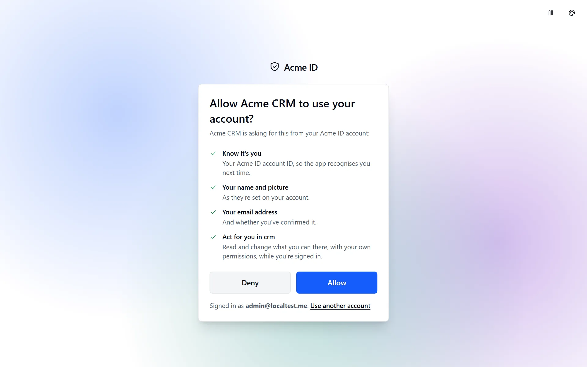
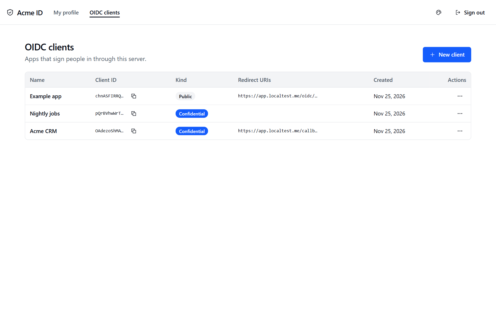

# Next-Identity Server

**The identity server you run yourself.** OpenID Connect and OAuth 2.0 for your apps and APIs, on your own domain and your own database. People create one account and use it to sign in to every app you connect.

[](https://github.com/sajanv88/next-identity-server/releases/latest)
[](https://github.com/sajanv88/next-identity-server/actions/workflows/pr.yaml)
[](https://github.com/sajanv88/next-identity-server/actions/workflows/e2e.yaml)
[](https://github.com/sajanv88/next-identity-server/actions/workflows/main.yaml)
[](https://sajanv88.github.io/next-identity-server/docs/)
[](LICENSE)

**[Read the guide](https://sajanv88.github.io/next-identity-server/docs/)**: from `docker compose up` to a Helm release, step by step, with screenshots: the first admin, social sign-in, scopes and APIs, PKCE and client secrets, security, SMTP and Kubernetes. · [Website](https://sajanv88.github.io/next-identity-server/) · [Releases](https://github.com/sajanv88/next-identity-server/releases)

<p>
  
  
</p>

## What you get

- **Sign-in:** sign-up with email confirmation, passwords, magic links and password reset
- **Social sign-in (optional):** Google, Microsoft, GitHub, and any OpenID Connect provider (Okta, Keycloak, Auth0…), each on when its keys are set
- **Two-factor authentication:** an authenticator app, with backup codes
- **My profile:** change the password, turn two-factor on or off, see where you're signed in and sign out one device or all of them
- **User management:** admins find people, disable or enable their accounts, sign them out everywhere (apps' tokens included), require or reset two-factor, change roles and delete accounts, with an email to the person and a history of every change
- **OpenID Connect:** the authorization code flow with PKCE, rotating refresh tokens, a consent screen, pushed authorization requests (PAR, RFC 9126), and an admin page to register apps
- **Your own APIs (optional):** JWT access tokens for each API (RFC 8707 resource indicators), API scopes, client credentials for services, back-channel logout, and a script that registers your apps from a file
- **Shared session:** one sign-in across your subdomains, for apps you trust
- **Bot protection (optional):** Cloudflare Turnstile on every form, checked on the server
- **Rate limits** on sign-in, sign-up, codes, tokens and every email, per client IP
- **Branded:** your name and logo on every page, in the emails (React Email, HTML and plain text) and in authenticator apps; light, dark or system, and six color themes
- **Observable (optional):** OpenTelemetry traces and metrics for every sign-in step, and browsers' web vitals
- **Shipped as** a multi-arch Docker image and a Helm chart, made for Argo CD

Built with Next.js 16, [Better Auth](https://www.better-auth.com), PostgreSQL 17 and Drizzle ORM, and the nuvui component library.

## Quick start

You need Docker, Node.js 26 and pnpm 12.

```sh
git clone https://github.com/sajanv88/next-identity-server.git && cd next-identity-server
pnpm install
cp .env.example .env      # set BETTER_AUTH_SECRET (openssl rand -base64 32) and SEED_ADMIN_PASSWORD
docker compose up -d      # PostgreSQL 17, on 127.0.0.1 only
pnpm db:migrate           # the tables
pnpm db:seed              # an admin, and the example app registered as a client
pnpm dev
```

| Address | What it is |
| --- | --- |
| <http://auth.localtest.me:3000> | The auth server. `*.localtest.me` always points to your own machine. |
| <http://app.localtest.me:3001> | The example app. In `.env`, set `EXAMPLE_CLIENT_ID` to the ID `db:seed` prints, and `EXAMPLE_SESSION_SECRET` to `openssl rand -base64 32`. |
| <http://localhost:3002> | The website and the guide (`apps/landing`). |

Emails are printed in the terminal in development, links included.

## Important settings

Every setting is an environment variable, checked at startup: a missing or wrong one stops the server with a message that names it. [.env.example](.env.example) lists them all; these are the ones to get right. In production (the image sets `NODE_ENV=production`) every URL must be https and email must go over SMTP.

| Setting | | What it is |
| --- | --- | --- |
| `BETTER_AUTH_URL` | config | The public origin, e.g. `https://auth.example.com`. It's also the OIDC issuer. |
| `BETTER_AUTH_SECRET` | **secret** | At least 32 random characters. Keep it the same for everything that uses the database (see [Deploy](#deploy)). |
| `DATABASE_URL` | **secret** | PostgreSQL 17, with TLS settings in the URL in production (`sslmode=verify-full`). |
| `TRUSTED_ORIGINS` | config | Every app origin that calls the server, comma-separated, exact, no wildcards. |
| `TRUSTED_PROXIES` | config | Your proxy's or ingress pods' addresses (IPs or CIDRs). Left empty, every request looks like it comes from the proxy, and everyone shares one rate limit. |
| `COOKIE_DOMAIN` | config | Optional: a parent domain, to share the session cookie with apps on its subdomains. |
| `EMAIL_PROVIDER`, `EMAIL_FROM` | config | `smtp` in production; `console` prints emails in development. |
| `SMTP_HOST`, `SMTP_PORT`, `SMTP_USER` | config | Port 465 is TLS from the first byte; any other port must offer STARTTLS. The certificate is always verified. |
| `SMTP_PASSWORD` | **secret** | The SMTP password or API token. |
| `TWO_FACTOR_REQUIRED_FOR_ADMINS` | config | Optional: `true` makes every admin set up two-factor before anything else. Admins can require it of anyone on **/admin/users**. |
| `APP_NAME`, `LOGO_URL` | config | Optional: your product's name and a square logo (https), on every page and in the emails. |
| `OAUTH_RESOURCES`, `OAUTH_API_SCOPES` | config | Optional: your APIs (e.g. `https://api.example.com`) and their scopes (e.g. `crm,booking`). An API's tokens can last less than the server's: `https://api.example.com access=5m refresh=8h`. |
| `ACCESS_TOKEN_LIFETIME`, `ID_TOKEN_LIFETIME`, `REFRESH_TOKEN_LIFETIME` | config | Optional: how long tokens last, as `15m`, `8h` or `30d`. Access and ID tokens 10 minutes by default (1 minute to 24 hours), refresh tokens 30 days (1 hour to 365 days). |
| `GOOGLE_*`, `MICROSOFT_*`, `GITHUB_*`, `SSO_*` | config, **secret** | Optional: each sign-in provider is on when its client ID (config) and its `*_CLIENT_SECRET` (secret) are both set. |
| `TURNSTILE_SITE_KEY`, `TURNSTILE_SECRET_KEY` | config, **secret** | Optional: Cloudflare Turnstile, both or neither. |
| `OTEL_EXPORTER_OTLP_ENDPOINT` | config | Optional: an OpenTelemetry collector (OTLP over HTTP). No email addresses, passwords or tokens are recorded. |

## Connect an app

1. Sign in as an admin, open **/admin/clients** and add the app with its redirect URI. A confidential client (an app with a server) gets a secret, shown once; a public one (a single-page or mobile app) uses PKCE alone.
2. Point the app's OIDC library at the issuer. Everything else comes from `/.well-known/openid-configuration`.
3. Use the authorization code flow with PKCE (S256), which every sign-in requires. Scopes: `openid`, `profile`, `email`, and `offline_access` for a refresh token.

[apps/example-client](apps/example-client) is a small working example, and the [guide](https://sajanv88.github.io/next-identity-server/docs/#pkce) walks through it by hand.

| Endpoint | What it's for |
| --- | --- |
| `GET /.well-known/openid-configuration` | Discovery: everything below, for your library |
| `GET /jwks` | The keys ID tokens and API tokens are signed with (RS256) |
| `GET /api/auth/oauth2/authorize` | Starts a sign-in |
| `POST /api/auth/oauth2/par` | Pushes a sign-in's parameters first (PAR) |
| `POST /api/auth/oauth2/token` | A code, a refresh token or client credentials for tokens |
| `GET /api/auth/oauth2/userinfo` | The signed-in user's claims |
| `POST /api/auth/oauth2/revoke`, `/introspect` | Revokes a token; says whether one is active |
| `GET /api/auth/oauth2/end-session` | Signs the user out here too (RP-initiated logout), back to a registered post-logout address |
| `GET /api/health` | For probes; never touches the database |

### Tokens for your own APIs

1. List your APIs and their scopes in `OAUTH_RESOURCES` and `OAUTH_API_SCOPES`.
2. Declare the apps in a JSON file, like [clients.example.json](apps/auth-server/scripts/clients.example.json):
   - `web` apps sign people in. `firstParty` skips the consent screen; use it only for your own apps. `backchannelLogoutUri` (https) is told when someone's session ends, so signing out of one app signs them out of all of them.
   - `machine` clients are services that call an API as themselves, with client credentials.
3. Run `pnpm clients:provision <file>` with `PROVISION_ADMIN_EMAIL` set to an admin. It creates what's missing and updates the rest, never deletes, and prints each new secret once. Run it again whenever the file changes.
4. Apps add `resource=https://api.example.com` to the authorization or token request. The access token is then a JWT whose `aud` is that API, which verifies it against `/jwks`. An app gets tokens only for the APIs it's linked to.

Apps on the same parent domain can read the shared session cookie instead of using OIDC. Only do that for apps you fully trust: every subdomain receives the cookie.

## Deploy

The [guide](https://sajanv88.github.io/next-identity-server/docs/#kubernetes) has every step; in short:

1. Create a Secret in your namespace with `BETTER_AUTH_SECRET`, `DATABASE_URL` and `SMTP_PASSWORD` (and each configured provider's or Turnstile's secret). The chart reads it, by the name in `existingSecret`, and never creates it.
2. Write a values file with your domain, ingress and `config` (the settings above that aren't secrets). [values.yaml](charts/auth-server/values.yaml) explains each one, and [values-production.yaml](charts/auth-server/values-production.yaml) is a starting point.
3. Install the chart at the latest release's version (the badge above), or sync it with Argo CD:

   ```sh
   helm install auth-server oci://ghcr.io/sajanv88/charts/auth-server --version 1.1.5 -n auth -f values.auth.yaml
   ```

   With Argo CD, the database migrations run as a PreSync Job before each rollout; with plain Helm, run them before an upgrade that changes the schema.
4. Sign up, then make yourself an admin: `update users set role = 'admin' where email = 'you@example.com';`

Keep `BETTER_AUTH_SECRET` the same for everything that uses the database: it encrypts the token-signing key stored there, and with another secret apps can't get tokens (the token endpoint answers 500). To change it, also delete the rows of the `jwks` table; a new key is made, and apps verify against it from `/jwks`.

## Releases

| What | Where |
| --- | --- |
| The image of every commit on `main` | `ghcr.io/sajanv88/auth-server:sha-<short-sha>` and `:main` |
| A release `vX.Y.Z` | `ghcr.io/sajanv88/auth-server:vX.Y.Z` and `:latest`, the same image retagged, with provenance and an SBOM |
| Its Helm chart | `oci://ghcr.io/sajanv88/charts/auth-server`, version `X.Y.Z` |

Both are public, for linux/amd64 and linux/arm64. Each [GitHub Release](https://github.com/sajanv88/next-identity-server/releases) carries the chart, the image digest and the SBOM.

## Tests

| Suite | What it covers | Runs |
| --- | --- | --- |
| Unit and integration, 310 tests (Vitest) | The real Better Auth configuration over HTTP against an in-memory Postgres (PGlite): sign-in, two-factor, consent, OIDC flows, API tokens, PAR, the admin's clients, emails, the database queries, and the example app | Every pull request |
| End to end, 38 scenarios (Playwright, BDD) | Sign-up, sign-in, password reset, account security, two-factor and OIDC with the example app, in Chromium against the running apps | Every second day, and by hand |
| Checks | Biome, stylelint, TypeScript, the build, a Docker image with a health check, and the Helm chart (lint and kubeconform) | Every pull request |

```sh
pnpm typecheck && pnpm lint && pnpm test && pnpm build
pnpm test:e2e             # needs a database, a seeded admin and EXAMPLE_CLIENT_ID; see apps/tests
```

## Project layout

```
apps/auth-server       the server (Next.js 16): routes in src/app, one folder per feature in src/features
apps/example-client    a demo app that signs in with it (shared cookie, and OIDC with PKCE)
apps/landing           the website and the guide, a static export on GitHub Pages
apps/tests             the end-to-end scenarios
packages/db            the schema, migrations and queries (Drizzle ORM)
charts/auth-server     the Helm chart
```

## License

[MIT](LICENSE)

## Author

Made by **[@sajanv88](https://github.com/sajanv88)** · [sajankumarv.com](https://sajankumarv.com)
